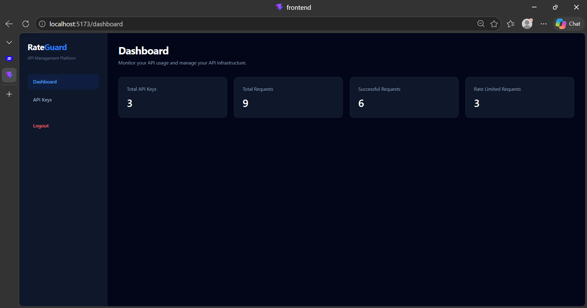
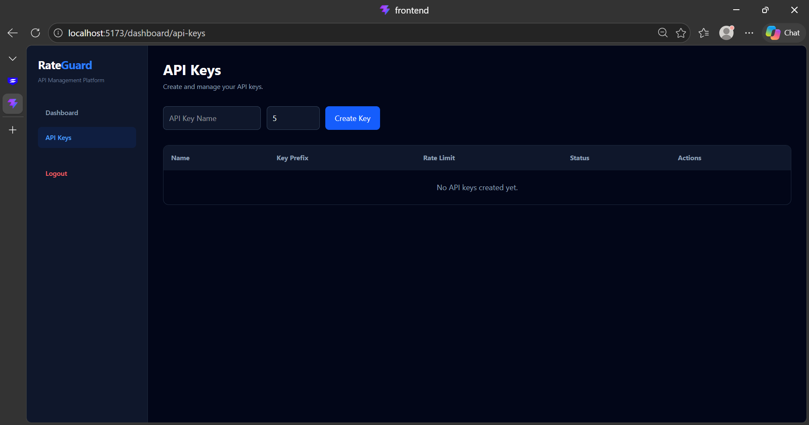

# RateGuard – API Gateway with Rate Limiting

## Introduction

RateGuard is a backend-focused API gateway that protects APIs from excessive requests using API key authentication and the Token Bucket rate-limiting algorithm.

It acts as an intermediary between client applications and backend services, controlling request traffic, preventing excessive API usage, and maintaining request logs for analytics.

## Features

- **User Authentication:** Secure signup and login using JWT.
- **API Key Management:** Generate, view, activate, deactivate, and delete API keys.
- **API Key Validation:** Authenticate incoming client requests.
- **Rate Limiting:** Control request traffic using the Token Bucket algorithm.
- **Automatic Token Refill:** Refill available tokens over time using Redis and Lua.
- **Request Logging:** Store successful and rejected requests in MongoDB.
- **Dashboard Analytics:** Track total, successful, and rate-limited requests.
- **API Proxying:** Forward permitted requests to the backend and reject excess requests with HTTP 429.

## Tech Stack

**Frontend:** React.js, Tailwind CSS, Axios

**Backend:** Node.js, Express.js

**Database:** MongoDB

**Rate Limiting:** Redis, Lua

**Authentication:** JWT, API Keys

**Version Control:** Git, GitHub

## System Architecture

RateGuard consists of three main components:

- **Frontend:** Provides the dashboard for user authentication, API key management, and usage analytics.
- **Gateway:** Validates API keys, applies rate limiting, forwards permitted requests, and logs request activity.
- **Backend:** Handles the actual API operations requested by clients.

### Request Flow

Client Application → RateGuard Gateway → API Key Validation → Redis Token Bucket → Backend API

`Requests exceeding the rate limit receive an HTTP 429 response. Request outcomes are recorded in MongoDB and displayed through dashboard analytics.`

## Token Bucket Algorithm

RateGuard uses the Token Bucket algorithm to control the number of requests a client can make.

- Each API key has a bucket with a defined token capacity.
- Every incoming authenticated request consumes one token.
- If tokens are available, the request is allowed.
- If the bucket is empty, the request is rejected with HTTP 429 (Too Many Requests).
- Tokens are automatically refilled over time.
- Redis stores the bucket state, while Lua scripts ensure atomic token updates.

This approach allows controlled bursts of requests while maintaining a defined request rate.

## Project Structure

The project is divided into three main directories:

RateGuard/
├── Backend/
│   ├── controllers/
│   ├── models/
│   ├── routes/
│   ├── app.js
│   └── server.js
│
├── Frontend/
│   └── frontend/
│       ├── src/
│       │   ├── components/
│       │   ├── context/
│       │   ├── hooks/
│       │   ├── pages/
│       │   └── services/
│       ├── public/
│       └── package.json
│
├── Gateway/
│   ├── config/
│   ├── controllers/
│   ├── middleware/
│   ├── models/
│   ├── routes/
│   ├── scripts/
│   ├── services/
│   ├── app.js
│   └── server.js
│
└── .gitignore

## API Endpoints

### Authentication

- `POST /api/auth/signup` – Register a new user.
- `POST /api/auth/login` – Authenticate a user.
- `GET /api/auth/get-me` – Retrieve the logged-in user's session.
- `POST /api/auth/logout` – Log out the user.

### API Key Management

- `POST /api/createkeys` – Generate a new API key.
- `GET /api/fetchkeys` – Retrieve the user's API keys.
- `PATCH /api/updatekeys/:id` – Activate or deactivate an API key.
- `DELETE /api/deletekeys/:id` – Delete an API key.

### Dashboard

- `GET /api/dashboard/overview` – Retrieve API key count and request statistics for the logged-in user.

### Gateway

Client applications send requests to the Gateway with an API key in the `x-api-key` request header. The Gateway validates the key, applies rate limiting, and forwards permitted requests to the backend.

## Installation and Setup

### Prerequisites

- Node.js and npm
- MongoDB
- Redis

### 1. Clone the Repository

git clone YOUR_REPOSITORY_URL
cd RateGuard

### 2. Install Dependencies

Install dependencies separately in the Backend, Gateway, and Frontend application directories:

cd Backend
npm install

cd ../Gateway
npm install

cd ../Frontend/frontend
npm install

### 3. Configure Environment Variables

Create `.env` files in the respective application directories.

Configure the required values for:

- MongoDB connection
- Redis connection
- JWT secret
- Server ports
- Any other environment variables used by the application

Refer to the application's configuration files for the exact variable names.

### 4. Run the Applications

Start the Backend, Gateway, and Frontend development servers in separate terminals:
# Backend
cd Backend
npm start

# Gateway
cd Gateway
npm start

# Frontend
cd Frontend/frontend
npm run dev

Use the appropriate npm scripts defined in each application's `package.json` if they differ.

## Screenshots

### Dashboard

### API Key Management

